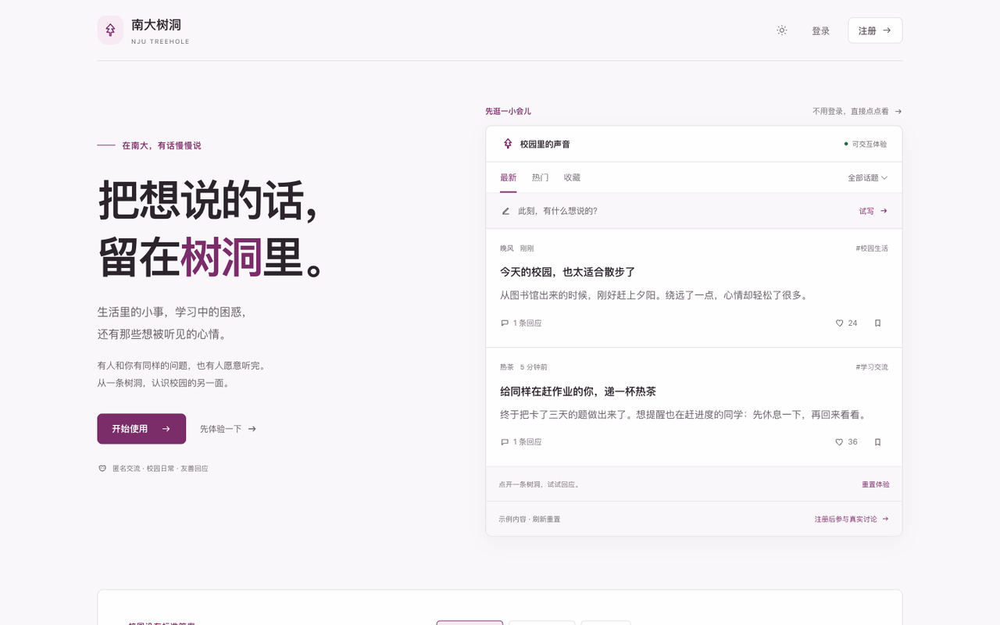
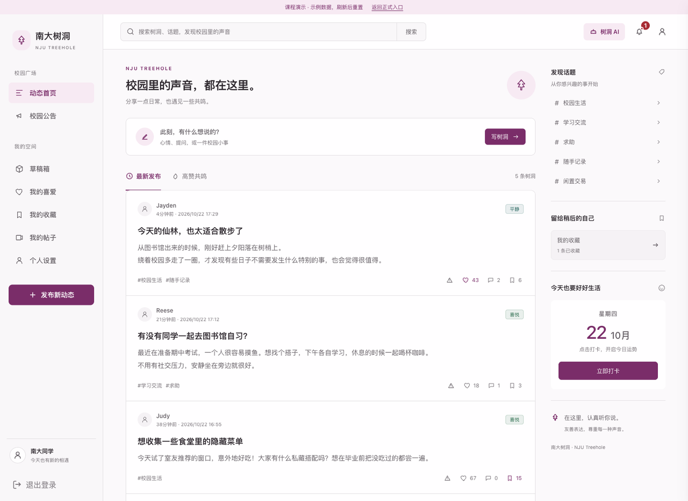
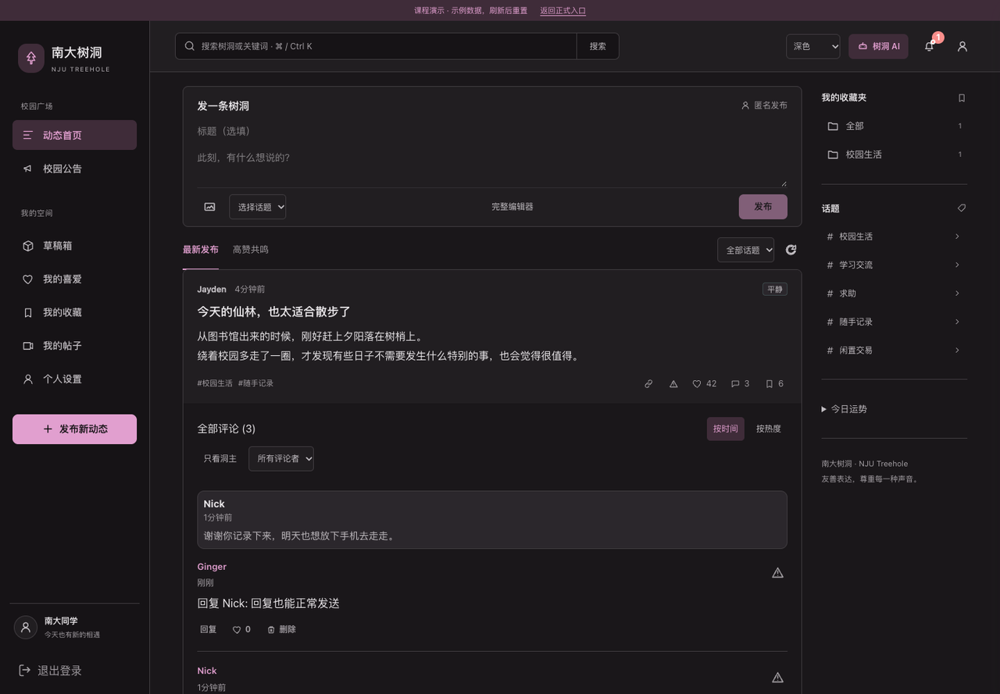

<div align="center">

# 南大树洞

**半匿名的南大校园社区：前台匿名表达，后台可治理追责**


[快速开始](#快速开始) · [界面预览](#界面预览) · [功能一览](#功能一览) · [技术架构](#技术架构) · [常见问题](#常见问题) · [文档地图](#文档地图)



</div>

## 这是什么

一套前后端分离的校园社区系统。它真正想处理的不是“匿名发帖”这个功能，而是校园场景里低压力表达和内容治理之间的矛盾：对普通用户保持半匿名，对管理员保留可追溯的处置手段。

仓库已经跑通完整主链路——注册登录、匿名发帖、评论回复、点赞收藏、通知中心、校园公告与活动、带工具调用的 AI 助手，以及管理后台。当前版本同时是人机交互课程的界面改版作业，交互与主题的设计说明见 [前端改版说明](docs/frontend-redesign.md)。

先划清边界：这是课程项目，不是生产级匿名社交产品。页面里的内容都是虚构的演示数据；图片存储、限流、CSRF 防护等仍属于明确的待办项，见 [已知限制](#已知限制)。

## 界面预览

<p align="center">
  
  
</p>

<p align="center">
  
</p>

<p align="center"><sub>桌面信息流 · 移动端布局 · 深色主题与评论区</sub></p>

## 快速开始

### 方式一：只看前端，不需要后端

```bash
git clone https://github.com/Joylllll1/HCIProj.git
cd HCIProj/frontend
npm ci
npm run dev:demo
```

浏览器会自动打开 `http://127.0.0.1:5173/?preview=1`（没自动打开就手动访问）。演示数据只存在当前页面内存里，刷新即重置；未支持的操作会提示改用正式入口。演示代码只在 Vite 开发模式加载，不会打进生产构建。

### 方式二：完整跑通前后端

前置依赖：Node.js ≥ 18、npm、MongoDB（本地或远程实例）。

```bash
# 1. 后端
cd backend
npm ci
cp .env.example .env      # 至少修改 JWT_SECRET 与 JWT_REFRESH_SECRET
npm run dev               # http://localhost:3001

# 2. 另开终端，写入演示账号（可选）
cd backend
node src/scripts/seedUsers.js

# 3. 前端
cd frontend
npm ci
npm run dev               # http://localhost:5173
```

开发环境下，前端通过 Vite 把 `/api/*` 代理到 `http://localhost:3001`，浏览器只需要访问前端地址。

| 服务 | 地址 |
|------|------|
| Web | http://localhost:5173 |
| API | http://localhost:3001 |
| 健康检查 | http://localhost:3001/api/health |

跑过 `seedUsers.js` 后可用以下账号登录：

| 角色 | 邮箱 | 密码 |
|------|------|------|
| 管理员 | `admin@nju.edu.cn` | `12345678` |
| 普通用户 | `test@nju.edu.cn` | `12345678` |

> 没有配置 SMTP 时，邮箱验证码不会真正发送，而是打印在后端控制台日志里，仅适合本地调试。

## 功能一览

| 模块 | 当前能力 |
|------|----------|
| 认证与用户 | 邮箱注册、密码登录、邮箱验证码、找回与修改密码、个人资料与通知偏好 |
| 内容社区 | 匿名发帖、帖子详情、评论与回复、删除自己的内容、举报 |
| 互动与收藏 | 帖子 / 评论 / 回复点赞、收藏夹管理、草稿箱、我的帖子 / 喜欢 / 收藏 |
| 通知中心 | 未读数、单条与全部已读、点击跳转；SSE 触发刷新，轮询兜底 |
| 公告与活动 | 公告流、活动申请、我的申请记录、管理端审核 |
| AI 助手 | 多会话、SSE 流式回复、停止与重新生成、人格设置；可总结当前帖子与评论区、查看站内热点、联网搜索并抓取网页正文二次核实 |
| 管理后台 | 举报处理、删帖删评、封禁 / 解禁、审计日志、活动审核 |
| 实时能力 | 新帖、删帖、帖子统计、评论与回复变更通过 SSE 同步 |
| 体验细节 | 桌面 / 移动端布局、浅色 / 深色 / 跟随系统、图片灯箱、Toast、首页搜索与后端分页排序 |

## 技术架构

| 层次 | 选型 |
|------|------|
| 前端 | React 18 · Vite 5 · Tailwind CSS v4 · Zustand 5 · GSAP |
| 后端 | Node.js ESM · Express 4 · MongoDB · Mongoose 8 |
| 鉴权 | JWT + HTTP-only Cookie（`accessToken` / `refreshToken`） |
| 实时通信 | SSE（Server-Sent Events） |
| AI | OpenAI 兼容 Chat Completions 接口 · 后端 tool call + SSE 流式输出 |
| 测试 | Vitest · Testing Library · Node `--test` |
| 工程化 | ESLint · GitHub Actions |

```text
HCIProj/
├── frontend/          React 单页应用（Vite + Tailwind + Zustand）
│   └── src/
│       ├── components/  common · features · layout · pages
│       ├── hooks/  services/  store/  utils/
│       └── test/        测试初始化
├── backend/           Express + MongoDB API
│   └── src/
│       ├── controllers/  routes/  models/  middlewares/
│       ├── services/     业务逻辑、llm/、tools/、SSE
│       └── scripts/      种子数据
├── docs/              wiki、设计说明与方案记录
└── output/            界面截图与验证产物
```

几个影响使用方式的实现约束：

- 前后端同源：开发时靠 Vite 代理，生产环境建议由 Nginx 把静态资源与 `/api` 挂到同一 origin
- 登录态基于 HTTP-only cookie，`accessToken` 默认 15 分钟、`refreshToken` 默认 7 天；受保护请求遇到 401 会静默刷新并重放一次
- 通知中心采用“SSE 事件触发刷新 + 轮询兜底”，并非纯推送完整通知列表
- 前端路由仍以 `activePage + history API` 为主，尚未迁移到 React Router
- AI 的工具范围仅限帖子总结、站内热点、联网搜索与网页抓取，不包含找组队、二手交易等业务工具

更完整的设计取舍见 [架构说明](docs/wiki/architecture.md)。

## 常用命令

| 位置 | 命令 | 说明 |
|------|------|------|
| `frontend/` | `npm run dev` | 启动开发服务器 |
| `frontend/` | `npm run dev:demo` | 无后端演示模式 |
| `frontend/` | `npm run build` / `npm run preview` | 生产构建与本地预览 |
| `frontend/` | `npm run lint` / `npm test` | ESLint / Vitest |
| `backend/` | `npm run dev` / `npm run start` | nodemon 热重载 / 生产启动 |
| `backend/` | `npm run lint` / `npm test` | ESLint / Node 原生测试 |
| `backend/` | `node src/scripts/seedUsers.js` | 创建演示用户 |
| `backend/` | `npm run seed:fortune` | 初始化每日运势数据 |

## 环境变量

`backend/.env.example` 是完整模板，最小可运行配置如下：

```env
PORT=3001
MONGODB_URI=mongodb://127.0.0.1:27017/treehole
JWT_SECRET=replace-me
JWT_REFRESH_SECRET=replace-me-too
JWT_EXPIRES_IN=15m
JWT_REFRESH_EXPIRES_IN=7d
```

| 变量 | 何时需要 |
|------|----------|
| `SMTP_HOST` / `SMTP_PORT` / `SMTP_USER` / `SMTP_PASS` | 需要真实发送验证码时；不配置则验证码打印在控制台 |
| `LLM_API_KEY` | 需要 AI 助手时；不配置时 AI 接口返回“AI 服务未配置”，不影响其他模块 |
| `LLM_API_URL` / `LLM_MODEL` | 需要切换 AI 提供方或模型时；默认 DeepSeek 兼容接口 |
| `AI_WEB_SEARCH_BAIDU_API_KEY` / `AI_WEB_SEARCH_BAIDU_URL` | 需要 AI 联网搜索时；不配置仍可聊天，但拿不到稳定的实时信息 |
| `ADMIN_CONTACT_QQ` | 禁言 / 解禁通知文案里的联系信息 |
| `VERIFY_CODE_EXPIRES_MIN` | 验证码有效期，默认 5 分钟 |
| `COOKIE_SAME_SITE` / `ACCESS_COOKIE_MAX_AGE_MS` / `REFRESH_COOKIE_MAX_AGE_MS` | 微调 cookie 策略 |

## 测试与 CI

```bash
# 前端
cd frontend && npm test && npm run lint && npm run build

# 后端
cd backend && npm test && npm run lint
```

前端用 Vitest + Testing Library 覆盖 `App`、部分页面、`store` 与 `apiClient`；后端用 Node 原生测试覆盖 JWT、cookie、鉴权响应等工具层。目前没有端到端 E2E 链路。

GitHub Actions 会在推送到 `main` / `master` 或提交 PR 时，分别对前端执行 lint / test / build，对后端执行 lint / test。本地命令仍是质量保障的主力。

## 已知限制

- 图片以内联 base64 Data URL 传输，列表接口偏重，存储治理尚未开始
- 通知中心不是纯 SSE 推送，依赖前端刷新 + 轮询兜底
- 安全面仍有缺口：验证码限流与爆破防护、上传额度与资源清理、更严格的 CORS / 安全头 / CSRF 方案
- 前端尚未迁移到 React Router

更细的待办见 [docs/wiki/todo.md](docs/wiki/todo.md)。

## 常见问题

**前端页面正常，但接口全部 401 或没有数据？**
依次检查后端是否启动、MongoDB 是否可连、`backend/.env` 是否存在且配置正确。

**注册时收不到验证码？**
未配置 SMTP 时验证码只打印在后端控制台，这是预期行为。

**把前端和后端放在不同 origin，登录态就失效了？**
cookie 需要额外的跨域配置。推荐让两者同源，生产环境用反向代理挂到一起。

**后端测试提示找不到测试文件？**
先确认拉的是仓库当前版本，旧版本的测试脚本写法有过兼容性问题。

## 文档地图

| 文档 | 内容 |
|------|------|
| [AGENTS.md](AGENTS.md) | 给 AI coding agent 的项目约定与命令 |
| [docs/wiki/setup.md](docs/wiki/setup.md) | 环境搭建与常见问题 |
| [docs/wiki/architecture.md](docs/wiki/architecture.md) | 架构、SSE、登录态与约束 |
| [docs/frontend-redesign.md](docs/frontend-redesign.md) | 人机交互改版说明与验证记录 |
| [docs/design/product-brief.md](docs/design/product-brief.md) | 产品定位、用户与设计原则 |
| [docs/design/ui-spec.md](docs/design/ui-spec.md) | 界面规范：色彩、排版、组件与交互 |
| [docs/hci-usability-review.md](docs/hci-usability-review.md) | 可用性评审 |
| [docs/wiki/coding-standards.md](docs/wiki/coding-standards.md) | 编码规范 |
| [docs/wiki/conventions.md](docs/wiki/conventions.md) | 项目约定 |
| [docs/wiki/collaboration-workflow.md](docs/wiki/collaboration-workflow.md) | 协作流程 |
| [docs/wiki/decisions/](docs/wiki/decisions/) | 架构决策记录 |
| [docs/wiki/todo.md](docs/wiki/todo.md) | 已确认但未排期的后续事项 |

## 课程说明

本仓库是南京大学人机交互课程的课程作业，用于演示与评审设计取舍。界面设计参考了 [Treehole Art](https://arthals.ink/blog/treehole-art) 的交互思路（内容优先的信息流、就地发布、克制的配色），没有复制其代码或品牌素材。

演示数据均为虚构，不包含真实用户信息。仓库暂未附开源许可证；如需复用代码，请先联系作者。
